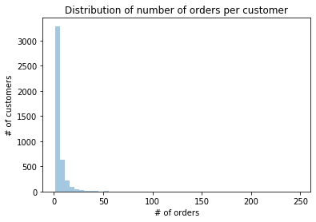
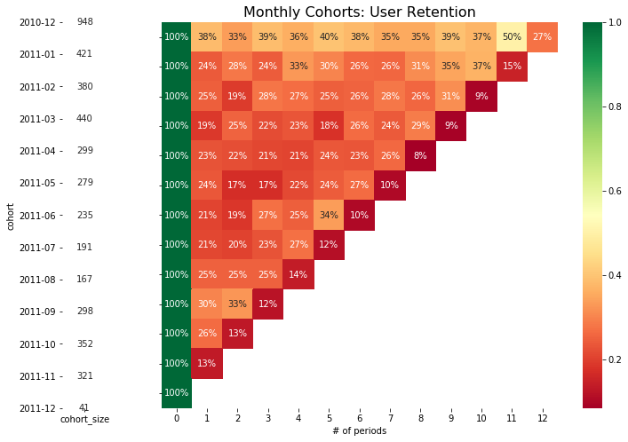
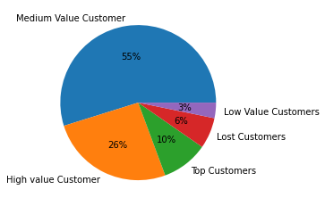
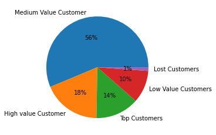

# Cohort retention and RFM segmentation

Portfolio analysis of the UCI Online Retail transactions: who comes back after a first purchase, and how customers in Germany and France split on recency, frequency, and spend.

Two notebooks, both left as originally run:

- [`Cohort.ipynb`](Cohort.ipynb) — monthly cohort retention.
- [`RFM_Analysis.ipynb`](RFM_Analysis.ipynb) — RFM scores and segments for Germany and France. The file was previously named `RMF Анализ.ipynb`; the method is RFM (Recency, Frequency, Monetary).

Figures below are the plots already stored in those notebooks, exported as PNG. Every count and rate is taken from a printed table, a printed value, or a label on those plots.

## Business task

The retailer sells gifts, mostly to UK customers, and the notebooks answer two operating questions:

1. Of the customers acquired in a given month, what share place another order one month later, and in the months after that?
2. Inside Germany and France, which customers are recent, which buy often, and which account for more spend?

Cohort retention shows whether new buyers stick. The RFM split shows how uneven the non-UK base is, which is the usual input for a keep / develop / win-back split.

## Dataset

[Online Retail](https://archive.ics.uci.edu/dataset/352/online+retail) (UCI Machine Learning Repository). A UK-based non-store retailer; the UCI description covers invoices from 1 December 2010 to 9 December 2011. The file used by both notebooks is `Online Retail.xlsx`. **That file is not in this repo.** Download it from the UCI page (direct file: [Online Retail.xlsx](https://archive.ics.uci.edu/ml/machine-learning-databases/00352/Online%20Retail.xlsx)) and put it in the same directory as the notebooks.

Columns, as named in the cohort notebook:

| Column | Meaning |
| --- | --- |
| InvoiceNo | Invoice id. A value starting with `C` is a cancellation. |
| StockCode | Product code. |
| Description | Product name. |
| Quantity | Units on the line. Can be negative. |
| InvoiceDate | Date and time of the invoice. |
| UnitPrice | Price per unit, in sterling. |
| CustomerID | Customer id. Missing for many rows. |
| Country | Customer's country. |

What the notebooks print about the file:

- `RFM_Analysis.ipynb` loads **541,909** rows and 8 columns. `CustomerID` is filled on **406,829** rows; `Description` on 540,455.
- After `Cohort.ipynb` drops rows with no `CustomerID`, `describe()` reports the same **406,829** rows. Quantity averages 12.061303 (median 5) and runs from **−80,995 to 80,995**. Unit price averages 3.460471 (median 1.95) and runs from 0 to 38,970. Cancellations and extreme lines are still in the frame; the only filter is a non-null customer id.
- The first printed invoice is `2010-12-01 08:26:00`. Cohort and order months both run from **2010-12 through 2011-12**.
- Line items by country are dominated by the United Kingdom (**495,478**). The next two are Germany (**9,495**) and France (**8,557**). The RFM notebook then studies those two.

## Methodology

### Cohort retention

`Cohort.ipynb` defines a customer's cohort as the calendar month of their earliest `InvoiceDate`. Each invoice line is also stamped with its own order month. Customers are counted with `nunique`, so a person who buys several products in one month counts once.

`period_number` is the number of months between the cohort month and the order month (0 is the month of the first purchase). The retention rate for a cohort at period *k* is the number of its customers who buy in that period, divided by the cohort size (the period-0 count). The heatmap annotates those rates as whole percents.

### RFM segmentation

`RFM_Analysis.ipynb` scores Germany and France separately, against a fixed reference date of **1 January 2012**. For each customer with an id:

- **Recency** — days from the reference date back to the customer's latest invoice.
- **Frequency** — number of invoice *lines* (`InvoiceNo` counted, not distinct invoices). The column is named `Frecuency`.
- **Monetary** — sum of `Quantity * UnitPrice`. The column is named `Monetray`.

Each metric is cut at that country's own quartiles and scored 1–4: 1 at or below the 25th percentile, 2 at or below the median, 3 at or below the 75th percentile, 4 above that. A **lower recency in days gets a lower R-score**, so the most recent customers score 1 on R and the longest-silent customers score 4. Higher line counts and higher spend score higher on F and M.

`RFM_Score` is half the sum of the three scores, so it falls on the half-points from 1.5 to 6. The notebook then labels:

| Rule | Segment label in the notebook |
| --- | --- |
| score > 4.5 | Top Customers |
| score > 4 | High value Customer |
| score > 2.5 | Medium Value Customer |
| score > 1.6 | Low Value Customers |
| otherwise | Lost Customers |

Because R rises as the customer gets older, a high score means a long gap since the last order together with many lines or high spend. The most recent customers receive the lowest R points. The segment names below are the labels the notebook applies with that rule.

## Findings

### Most buyers return, and almost all of them buy only a few times

After the customer-id filter there are **4,372** customers. **69.97%** of them have more than one invoice (`nunique` of `InvoiceNo`). The histogram of invoices per customer is sharply right-skewed: the mass sits in the first bin, and the axis runs out to 250 orders, so a thin tail buys far more often than the rest.



The cohort sizes sum to the same 4,372 customers. December 2010 is the large acquisition month (**948** customers). Later months are smaller, and December 2011 has **41** — the UCI file ends on 9 December 2011, so that cohort is a stub.

| Cohort | Customers | Share back in the next month |
| --- | ---: | ---: |
| 2010-12 | 948 | 38% |
| 2011-01 | 421 | 24% |
| 2011-02 | 380 | 25% |
| 2011-03 | 440 | 19% |
| 2011-04 | 299 | 23% |
| 2011-05 | 279 | 24% |
| 2011-06 | 235 | 21% |
| 2011-07 | 191 | 21% |
| 2011-08 | 167 | 25% |
| 2011-09 | 298 | 30% |
| 2011-10 | 352 | 26% |
| 2011-11 | 321 | 13% |
| 2011-12 | 41 | — |

Percents are the whole-number labels on the heatmap (`fmt='.0%'` of the printed retention matrix). The underlying month-1 rate for December 2010 is **0.381857** (362 of 948 customers).



The December 2010 cohort stays in a band of roughly 33–40% for most later periods (printed rates from 0.334388 at period 2 to 0.396624 at period 5). Period 11 is exactly **50%** (474 of 948). Period 12 is **27%** (260 of 948, printed rate 0.274262).

Later cohorts come back less often in month 1 (19–30% in the table above, except the short November 2011 window at 13%). The last observed cell of several 2011 cohorts is also thin: 15% for January at period 11 (0.149644), 9% for February at period 10 (0.092105), 9% for March at period 9 (0.088636), 8% for April at period 8 (0.083612). Those last cells land in December 2011, which only contains a few days of invoices.

### Germany and France: shipping lines, an autumn peak, and a broad middle segment

The country section is descriptive, before the RFM scores.

Most common descriptions by line count:

- France: `POSTAGE`, `RABBIT NIGHT LIGHT`, `RED TOADSTOOL LED NIGHT LIGHT`.
- Germany: `POSTAGE`, `ROUND SNACK BOXES SET OF4 WOODLAND`, `REGENCY CAKESTAND 3 TIER`.

`POSTAGE` leads both lists, so the ranking is counting invoice lines, shipping charges included.

The month with the most lines is **November** in France and **October** in Germany (month numbers 11 and 10 in the notebook output).

On German lines, mean unit price is **3.96693**, mean quantity is **12.369458**, and mean line revenue (`UnitPrice * Quantity`) is **23.348942601368996**. The five German descriptions with the highest summed line revenue are:

| Description | Revenue |
| --- | ---: |
| POSTAGE | 20,821.00 |
| REGENCY CAKESTAND 3 TIER | 8,257.35 |
| ROUND SNACK BOXES SET OF4 WOODLAND | 3,554.70 |
| ROUND SNACK BOXES SET OF 4 FRUITS | 1,949.95 |
| SPACEBOY LUNCH BOX | 1,629.45 |

The largest customer–description sums of `UnitPrice` are `Manual` lines, not catalog products: France customer 12536 at 12,493.42, then 12669 at 2,272.60; Germany customer 12473 at 2,068.18, then 13810 at 1,199.00.

### RFM: both countries are mostly "Medium Value Customer"

The Germany result table has **31** customers. The slice labels on its pie, and the row counts behind them, are:

| Segment | Customers | Share on the pie |
| --- | ---: | ---: |
| Medium Value Customer | 17 | 55% |
| High value Customer | 8 | 26% |
| Top Customers | 3 | 10% |
| Lost Customers | 2 | 6% |
| Low Value Customers | 1 | 3% |



France's result table has **87** customers. The notebook shows the head and tail, not every row, so the segment mix below is the pie's own labels:

| Segment | Share on the pie |
| --- | ---: |
| Medium Value Customer | 56% |
| High value Customer | 18% |
| Top Customers | 14% |
| Low Value Customers | 10% |
| Lost Customers | 1% |



In both countries the middle label is more than half the pie. Germany puts a larger share in `High value Customer` (26% versus 18%); France puts a larger share in `Top Customers` (14% versus 10%).

Two German rows show how the recency direction affects the label. Customer **12442** last bought on 2011-12-06 (recency **26** days) but has only 12 lines and monetary 172.06, so R = F = M = 1, the score is **1.5**, and the label is **Lost Customers**. Customer **12354** last bought on 2011-04-21 (recency **255** days) with 58 lines and monetary 1,079.40, so the scores are 4, 3, and 3, the score is **5.0**, and the label is **Top Customers**. Monetary totals also still include negative lines: German customer 12503 is printed at **−1,126.00**.

## How to run

The notebooks were executed with Python 3.7.3 (`Cohort.ipynb`) and Python 3.9.7 (`RFM_Analysis.ipynb`). They do not record package versions. `requirements.txt` pins pandas 1.0.5, numpy 1.18.5, matplotlib 3.3.4, and seaborn 0.11.2, plus xlrd 1.2.0 so `read_excel` can open the workbook.

Those pins are there because of two calls in the notebooks. `Cohort.ipynb` passes `infer_datetime_format=True` to `read_excel`; pandas 1.0.5 still accepts that keyword, and pandas 1.1 and later raise `TypeError`. The order histogram uses `seaborn.distplot`, which seaborn 0.11 still provides. pandas 1.0.5 publishes wheels for Python 3.7 and 3.8 only, so create the environment with one of those. The RFM notebook's kernel was 3.9.7; the same four libraries cover every import in that file.

```bash
python3.8 -m venv .venv
source .venv/bin/activate
pip install -r requirements.txt
```

Download `Online Retail.xlsx` from the [UCI Online Retail page](https://archive.ics.uci.edu/dataset/352/online+retail) and save it next to the notebooks. Both notebooks open that filename from the working directory.

Open `Cohort.ipynb` and `RFM_Analysis.ipynb` in Jupyter or Cursor and run them top to bottom. The cohort notebook also writes `retention_matrix.xlsx` in the working directory.

One cell in `Cohort.ipynb` draws the two-panel heatmap with a colormap named `white_cmap`. That name is not defined anywhere in the saved notebook, so a fresh run stops at that cell. The retention figure in this README is the output already stored from the original run (the cohort-size panel is white). Defining `white_cmap` as a white `ListedColormap` before that cell redraws the same panel. The earlier cells do not use that name.

## Кратко по-русски

Два ноутбука по данным UCI Online Retail. Файла `Online Retail.xlsx` в репозитории нет — его нужно скачать со [страницы UCI](https://archive.ics.uci.edu/dataset/352/online+retail) и положить рядом с ноутбуками.

`Cohort.ipynb` считает месячное удержание по когорте первой покупки. После удаления строк без `CustomerID` остаётся 406 829 строк и 4 372 клиента; **69,97%** заказывали больше одного раза. Крупнейшая когорта — декабрь 2010 (948 человек): в следующем месяце возвращаются 38% (0,381857), в 11-м периоде ровно 50% (474 из 948), в 12-м — 27% (260 из 948). У когорт 2011 года возврат в первый месяц ниже, обычно 19–30%.

`RFM_Analysis.ipynb` строит RFM для Германии и Франции от даты 1 января 2012 года. Recency, частота строк чека и сумма `Quantity * UnitPrice` режутся по квартилям страны на баллы 1–4; итоговый балл — половина суммы. Меньшее число дней с последней покупки даёт меньший R-балл. Сегменты: Top Customers, High value Customer, Medium Value Customer, Low Value Customers, Lost Customers. В таблице по Германии 31 клиент: на диаграмме 55% / 26% / 10% / 6% / 3%. Во Франции 87 клиентов: 56% / 18% / 14% / 10% / 1%, и средний сегмент снова больше половины.
